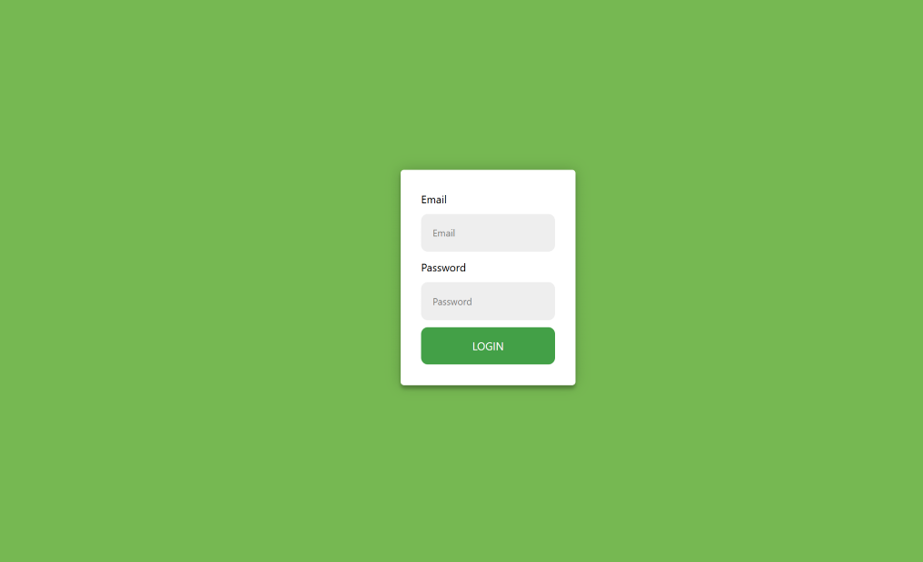
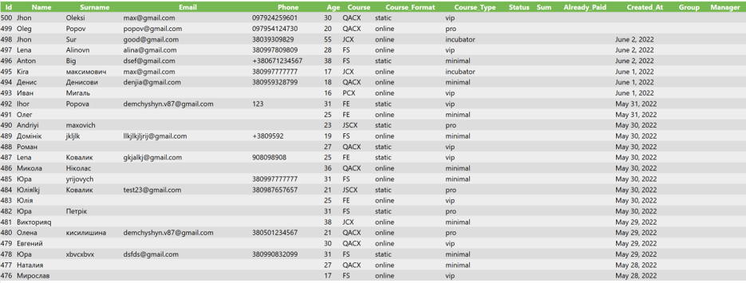
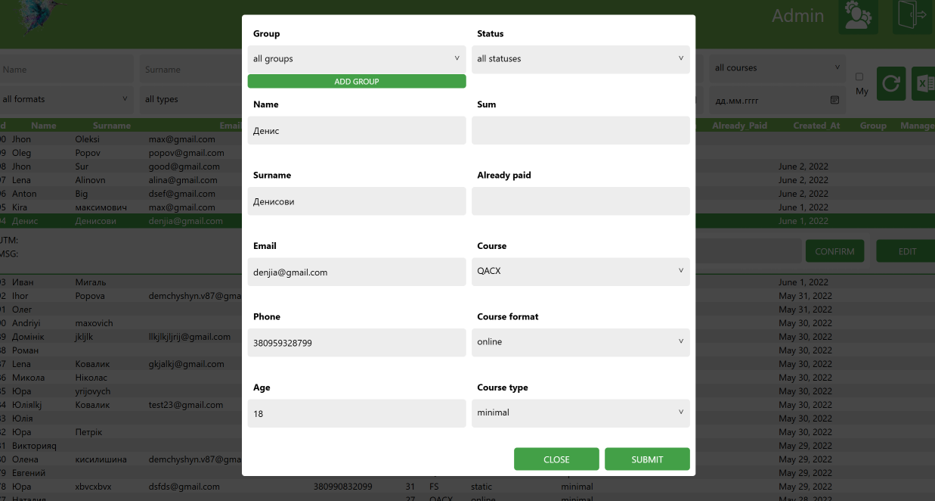
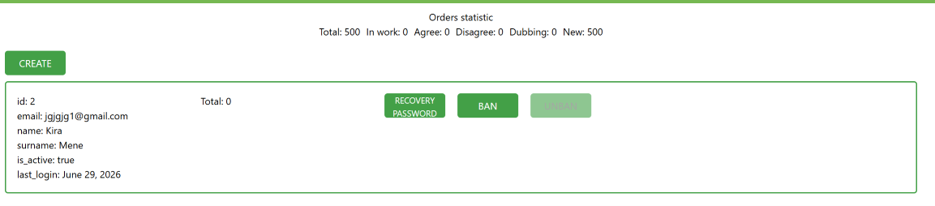

# CRM — Course-Sales Lead Management Platform

A CRM system for managing course-sales leads ("orders") end to end: capture leads through a public form, triage and work them through a status pipeline, keep a comment history on every lead, and manage staff, roles, and groups — all behind a JWT-authenticated Express API with a Next.js front end.

## Screenshots


| Login | Orders list |
| --- | --- |
|  |  |

| Order detail & comments | User management |
| --- | --- |
|  |  |

## Key Features

- **Public lead capture** — anyone can submit a lead through the `POST /orders` endpoint, no authentication required.
- **JWT authentication** — short-lived access tokens plus a refresh-token flow.
- **Role-based access control** — `admin` and `manager` roles with different permissions.
- **Order lifecycle** — leads move through `New → In work → Agree / Disagree / Dubbing`, with manager assignment and reassignment protection.
- **Comment history** — a per-order activity log so managers can track every interaction with a lead.
- **Groups** — simple named collections for organizing leads/users.
- **Excel export** — export the filtered orders list to `.xlsx`.
- **Admin-controlled accounts** — only admins create and activate accounts and handle password recovery, by sharing expiring token links through any channel (email, Telegram, etc.).

## Tech Stack

| Layer | Technologies |
| --- | --- |
| Backend | Node.js, TypeScript, Express, MongoDB (Mongoose), JWT, Joi, bcrypt |
| Frontend | Next.js (App Router), React, TypeScript, Tailwind CSS, axios |
| Infra | Docker Compose, nginx (reverse proxy) |

## Architecture

nginx is the single public entry point (port `8080`). It routes `/` to the Next.js frontend and `/api/` to the Express backend (stripping/adding the `/api` prefix — the backend itself is mounted unprefixed). The backend talks to MongoDB.

```
                      ┌────────────────────────┐
 client ──▶ nginx:8080 │ /       → frontend:5000 │
                      │ /api/   → backend:5000  │
                      └────────────────────────┘
                              │            │
                              ▼            ▼
                     Next.js frontend   Express backend
                                              │
                                              ▼
                                          MongoDB
```

## Project Structure

```
.
├── backend/            Express + TypeScript API (see backend/README.md)
├── frontend/            Next.js client application
├── docker-compose.yml   Orchestrates frontend, backend, and nginx
├── nginx.conf           Reverse-proxy routing for the compose "web" service
└── .env.example         Template for the required environment variables
```

## Getting Started

### Prerequisites

- [Docker](https://www.docker.com/) and Docker Compose
- Node.js (only needed if you want to run an app outside Docker) and MongoDB (local or a free MongoDB Atlas cluster)

### Quick start (Docker Compose)

```bash
git clone https://github.com/ElenaBanova/CRM.git
cd CRM
cp .env.example .env
# fill in the values in .env — see Environment Variables below
docker compose up --build
```

The app is then available at **http://localhost:8080** (nginx routes `/` to the frontend and `/api/` to the backend).

### First start (empty database)

The database starts empty, and the app has no sign-up, so follow these steps:

1. **Database.** Create a free [MongoDB Atlas](https://www.mongodb.com/atlas) cluster (or use a local MongoDB) and copy its connection string.
2. **Environment.** `cp .env.example .env` and fill in the values (see *Environment Variables* below), including `MONGO_URI`.
3. **Run.** `docker compose up --build`
4. **Create the administrator** (in a new terminal, in the same folder):
   ```bash
   docker compose exec backend npm run seed
   ```
   This creates **admin@gmail.com / admin** (demo credentials, local use only). The command is safe to repeat.
5. **Sign in** at http://localhost:8080.

**Optional: demo data.** To also add 3 groups and 60 test orders, run this instead of step 4:

```bash
docker compose exec backend npm run seed:demo
```

Demo orders are only added when there are no orders yet. You can also create orders yourself via `POST /orders` in Swagger (http://localhost:8080/api/docs/).

### Running the apps individually (without Docker)

Start the backend first, then the frontend.

**Backend**: see [`backend/README.md`](backend/README.md). It reads the root `.env` and must be started from the `backend/` folder (`cd backend && npm start`); it listens on `http://localhost:5000`.

**Frontend**: see [`frontend/README.md`](frontend/README.md). It needs its own `frontend/.env`:

```bash
cd frontend
cp .env.example .env
npm install
npm run dev
```

`frontend/.env` must contain `BASE_URL=http://localhost:5000` (the address of the running backend) and `ACCESS_LIFETIME`. The value `http://backend:5000` from the root `.env` only works inside Docker Compose. The app is then available at **http://localhost:3000**.

## Environment Variables

All variables are defined in [`.env.example`](.env.example) at the repo root. With Docker Compose, this one file is shared by every service via `env_file` in `docker-compose.yml`. See [`.env` files](#env-files) below for the standalone setup.

| Variable | Description |
| --- | --- |
| `PORT` | Port used by the backend and, in Docker, by the frontend too. Must be `5000`: nginx proxies to `frontend:5000` and `backend:5000` |
| `MONGO_URI` | MongoDB connection string |
| `JWT_ACCESS_SECRET` | Signing secret for access tokens |
| `JWT_REFRESH_SECRET` | Signing secret for refresh tokens |
| `JWT_ACCESS_LIFETIME` | Access token lifetime |
| `JWT_REFRESH_LIFETIME` | Refresh token lifetime |
| `JWT_ACTIVATE_SECRET` | Signing secret for account-activation links |
| `JWT_ACTIVATE_LIFETIME` | Expiry for account-activation links |
| `JWT_RECOVERY_SECRET` | Signing secret for password-recovery links |
| `JWT_RECOVERY_LIFETIME` | Expiry for password-recovery links |
| `FRONTEND_URL` | Base URL used to build activation/recovery links, which an admin copies and shares with the user through any channel (email, Telegram, etc.). With Docker (nginx): `http://localhost:8080`; with the frontend run standalone: `http://localhost:3000` |
| `BASE_URL` | Backend API base URL used by the frontend (server-side). In Docker: `http://backend:5000` |
| `ACCESS_LIFETIME` | Lifetime of the access-token cookie on the frontend, in seconds (should match `JWT_ACCESS_LIFETIME`, e.g. `600` for 10 minutes) |

### `.env` files

| Service | Run mode | File used |
| --- | --- | --- |
| Backend | Docker Compose | root `.env` (via `env_file`) |
| Backend | standalone (`cd backend && npm start`) | root `.env` (loaded by `dotenv` via `../.env`) |
| Frontend | Docker Compose | root `.env` (via `env_file`), `BASE_URL=http://backend:5000` |
| Frontend | standalone (`cd frontend && npm run dev`) | `frontend/.env`, `BASE_URL=http://localhost:5000` |

Variables set by Docker Compose take priority over `frontend/.env`, so the two setups do not conflict. The backend must be started from the `backend/` folder so that `../.env` resolves to the root `.env`.

## API Overview

The API is mounted at `/api` (via nginx) and split into four resources:

| Resource | Base path | Access                                                                 |
| --- | --- |------------------------------------------------------------------------|
| Auth | `/auth` | Public sign-in/refresh; admin-triggered activation & recovery          |
| Users | `/users` | Admin only                                                             |
| Groups | `/groups` | Authenticated                                                          |
| Orders (+ Comments) | `/orders` | Create is public (`POST /orders`); read/update/comment require auth, with manager-assignment restrictions |

For the full endpoint reference (exact routes, middleware chains, and request/response shapes), see [`backend/README.md`](backend/README.md).

Interactive Swagger/OpenAPI documentation is served by the backend at `/docs` (i.e. **http://localhost:8080/api/docs/** via nginx, or directly on the backend's port **http://localhost:5000/docs/** when running the backend without Docker).

## Roles & Access Control

- **admin** — manages users (create, update, role changes, block/unblock), generates account-activation and password-recovery links, and has unrestricted access to orders and groups.
- **manager** — works orders. A new order (status `New` or empty) is not assigned to anyone. It moves to `In work` and is assigned to a manager only when that manager actually changes one of its fields or leaves a comment; from then on, only that manager can update or comment on it. Moving an assigned order back to `New` releases it.

## Error Handling & Blocked Accounts

- Render and server-side request errors are caught by `error.tsx` / `global-error.tsx` ("Something went wrong, contact the administrator") with a retry button.
- Blocked accounts get `403 "Account is blocked"`: both on sign-in (the message is shown in the login form) and on any request with an active session (an axios interceptor redirects the user to `/login`).
- Activation/recovery links for a blocked user return `403 "Target user is blocked"`.
- Signing in with an account that has not been activated yet returns the same `401 "Invalid email or password"` as a wrong password, so the response does not reveal whether such an account exists.
- Activation and recovery links are one-time: once the password has been set, the same link is rejected by the API with `401 "Invalid or expired token"` (as is an expired or tampered link), and the form shows "This link is no longer valid. Ask the administrator for a new one."
- Server actions rethrow redirects and show friendly messages for backend failures.
- Admins cannot block themselves (`403 "No permitted"`) and do not see action buttons on their own card; the admin is always listed first on the managers page.